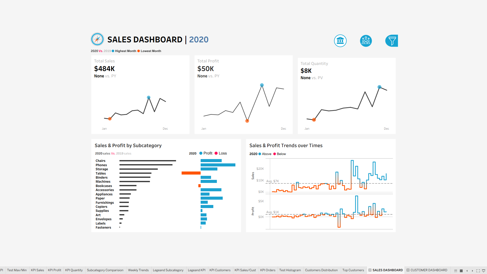
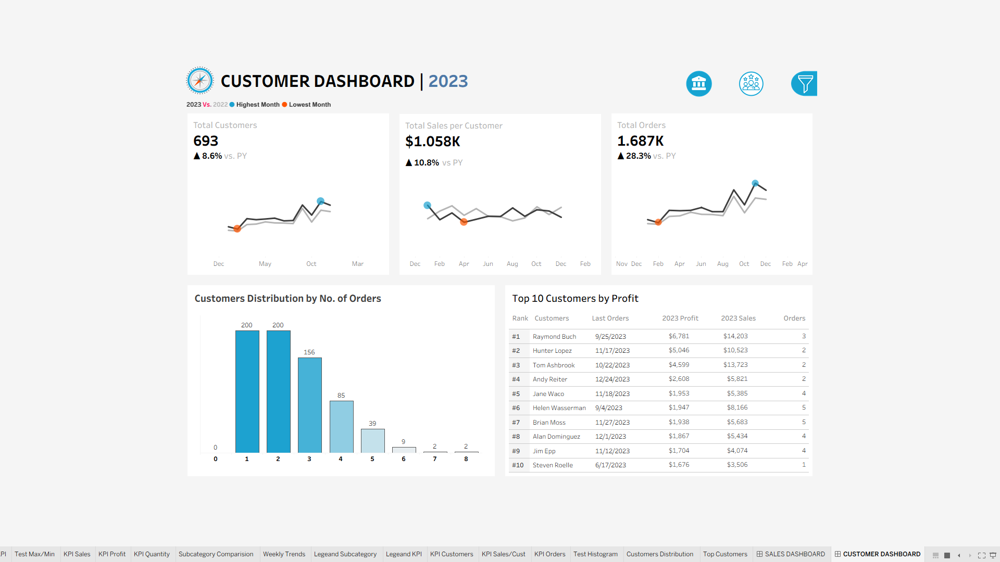

# 📊 Retail Sales & Customer Analytics Dashboard

🔗 **[View the Live Interactive Dashboard on Tableau Public](https://public.tableau.com/views/my_firstproject/CUSTOMERDASHBOARD)**

## 📝 Project Overview
This repository showcases an interactive, two-part Tableau dashboard designed to analyze retail sales performance and customer purchasing behavior. By transforming raw data into visual KPIs and trend lines, this project enables stakeholders to track year-over-year (YoY) growth, pinpoint profitable product categories, and understand customer distribution to drive strategic business decisions.

## 🎯 Dashboard Features & Insights

### 1. Sales Dashboard
* **High-Level KPIs:** Monitored Total Sales, Total Profit, and Total Quantity with dynamic YoY comparisons and high/low month indicators.
* **Product Performance:** Analyzed Sales & Profit by Subcategory to immediately identify high-revenue drivers versus loss-making items.
* **Time-Series Trends:** Visualized Weekly Sales & Profit Trends over time against benchmark averages to spot seasonal performance gaps.

### 2. Customer Dashboard
* **Customer Metrics:** Tracked Total Customers, Total Sales per Customer, and Total Orders, featuring strong YoY percentage growth metrics.
* **Order Distribution:** Mapped Customer Distribution by Number of Orders to understand purchasing frequency and loyalty.
* **Top Performers:** Generated a dynamic "Top 10 Customers by Profit" matrix detailing last order dates, total sales, and total profit per customer.

## 🎥 Dashboard Walkthrough
A brief demonstration of the interactive filters and view switching within the dashboard.

<video src="VISUALS/Dashboard_video.mp4" width="100%" controls></video>

## 📸 Dashboard Previews

### Sales Dashboard View

### Customer Dashboard View

## 🛠️ Tools & Technologies Used
- **Data Visualization:** Tableau
- **Data Processing:** Microsoft Excel / CSV
- **Version Control:** Git & GitHub

## 📁 Repository Structure
- `Book1.twbx`: The packaged Tableau workbook containing the dataset and interactive views.
- `visuals/`: Directory containing high-resolution dashboard screenshots (`Sales_Dashboard.png`, `Customer_Dashboard.png`) and the video walkthrough.

---
## 👩‍💻 About Me

Hi, I'm **Nidhi Singhal**! 👋

I am currently in my 3rd year of a B.Tech program and an aspiring **Business / Data Analyst**. I am passionate about transforming raw data into actionable insights and solving real-world problems through data-driven decision-making. 

My technical journey involves exploring SQL, designing data architecture, and building efficient workflows. I am always eager to learn new technologies, tackle complex analytical challenges, and collaborate on exciting tech projects. 

📫 **Let's Connect:**
- **LinkedIn:** [www.linkedin.com/in/nidhi-singhal-cse]
- **GitHub:** [@Nidhi-Singhal-0808](https://github.com/Nidhi-Singhal-0808)
- **Email:** [singhalnidhi0808@gmail.com]
